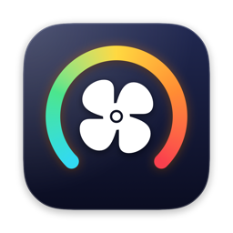
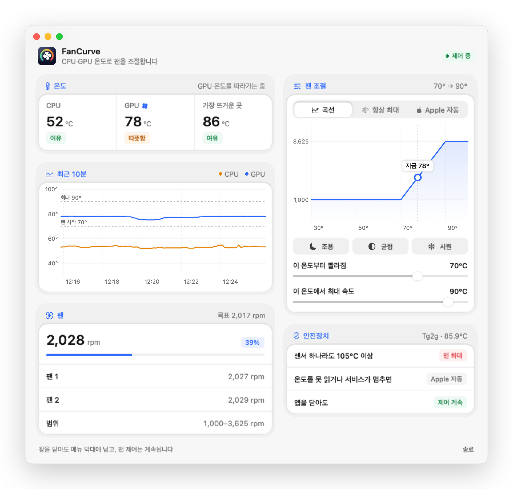
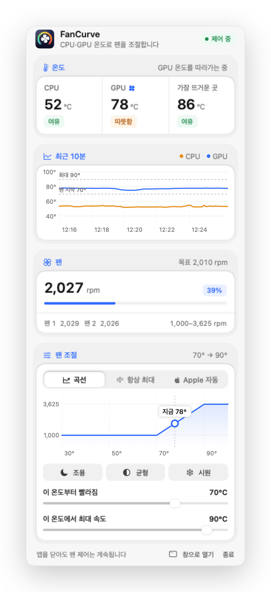
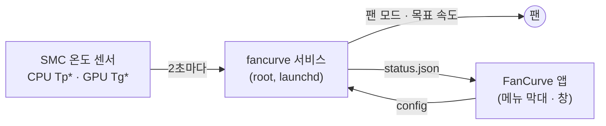

<div align="center">



# FanCurve

**CPU와 GPU 중 더 뜨거운 쪽을 따라가는 Mac 팬 곡선**

<p>
  
  
  
  
</p>

<a href="#설치">설치</a> · <a href="#사용법">사용법</a> · <a href="#작동-방식">작동 방식</a> · <a href="#안전장치">안전장치</a> · <a href="#자주-묻는-질문">자주 묻는 질문</a>

</div>

<br>

<picture>
  <source media="(prefers-color-scheme: dark)" srcset="docs/window-dark.png">
  
</picture>

## 왜 만들었나

Macs Fan Control 같은 앱은 센서 **하나**를 골라 팬을 맞춥니다. CPU 센서를 고르면 GPU 작업(로컬 LLM 같은)에서 칩이 뜨거워져도 팬이 느리고, GPU 센서를 고르면 반대가 됩니다.

FanCurve는 **CPU 평균과 GPU 평균 중 높은 쪽**을 2초마다 읽어 팬 곡선에 넣습니다. 어떤 작업을 돌리든 뜨거운 쪽을 따라갑니다.

## 기능

| | |
|---|---|
| 🌡️ **더 뜨거운 쪽을 따라감** | CPU 센서 평균과 GPU 센서 평균 중 높은 값으로 팬 속도를 정합니다. 지금 어느 쪽을 따라가는지 앱에 표시됩니다. |
| 🎚️ **곡선 / 항상 최대 / Apple 자동** | 프리셋 세 개(조용 · 균형 · 시원)와 슬라이더로 "몇 도부터 빨라질지, 몇 도에 최대일지"를 정합니다. |
| 🛡️ **안전장치** | 센서 하나라도 105°C에 닿으면 곡선과 관계없이 최대. 서비스가 멈추거나 온도를 못 읽으면 Apple 자동으로 되돌립니다. |
| 📈 **최근 10분 그래프** | CPU·GPU 온도 추이와 곡선 설정을 한 화면에서 봅니다. 메뉴 막대에는 지금 온도가 늘 보입니다. |
| 🪶 **가벼운 구조** | 팬 제어는 C로 쓴 작은 서비스가, 화면은 SwiftUI 앱이 맡습니다. 앱은 권한 없이 상태 파일만 읽습니다. |

## 설치

**필요 조건:** Apple Silicon Mac(M1 이후), macOS 14 Sonoma 이상

### 방법 1. 설치 패키지 (추천)

1. [Releases](../../releases)에서 `FanCurve-1.0.0.pkg`를 내려받아 엽니다.
2. 안내를 따라 설치하면 메뉴 막대에 팬 아이콘과 온도가 나타납니다.

> [!NOTE]
> 개발자 인증서로 서명하지 않은 패키지라, 처음 열 때 macOS가 "확인할 수 없음"이라며 막을 수 있습니다.
> **시스템 설정 → 개인정보 보호 및 보안**에서 맨 아래 **그래도 열기**를 누른 뒤 다시 여세요.

### 방법 2. 터미널 한 줄

```bash
curl -fsSL https://raw.githubusercontent.com/chanthr/FanCurve/main/install.sh | bash
```

최신 릴리스의 패키지를 내려받아 `installer`로 설치합니다. 저장소가 공개 상태일 때 동작합니다.

### 방법 3. 소스에서 빌드

```bash
xcode-select --install          # 빌드 도구가 없다면 한 번만
git clone https://github.com/chanthr/FanCurve.git
cd FanCurve
sudo ./fan.sh install
```

`./fan.sh package`를 실행하면 `dist/`에 같은 설치 패키지를 직접 만들 수 있습니다.

> [!IMPORTANT]
> **Macs Fan Control 같은 다른 팬 조절 앱**을 쓰고 있다면 그 앱의 팬 설정을 **자동**으로 두거나 앱을 종료하세요.
> 두 프로그램이 동시에 팬 속도를 쓰면 서로 덮어씁니다. FanCurve는 이를 감지하면 화면에 '충돌'로 알려 줍니다.

## 사용법

<table>
<tr>
<td width="46%">
<picture>
  <source media="(prefers-color-scheme: dark)" srcset="docs/menu-dark.png">
  
</picture>
</td>
<td>

**메뉴 막대**에서 팬 아이콘을 누르면 오른쪽 같은 창이 열립니다. 응용 프로그램 폴더나 Spotlight에서 **FanCurve**를 열면 넓은 창으로 볼 수 있고, 창을 닫으면 메뉴 막대에만 남습니다.

**팬 곡선**은 두 온도로 정합니다.

| 프리셋 | 빨라지기 시작 | 최대 속도 |
|---|---|---|
| 🌙 조용 | 55°C | 90°C |
| ◐ 균형 (기본) | 50°C | 80°C |
| ❄️ 시원 | 45°C | 72°C |

그 사이에서는 온도에 비례해 속도가 오릅니다. 빨라질 때는 바로, 느려질 때는 1분 남짓에 걸쳐 천천히 바뀌어 소리가 들쭉날쭉하지 않습니다.

**모드**
- **곡선**: 위 곡선을 따릅니다.
- **항상 최대**: 무거운 작업을 오래 돌릴 때.
- **Apple 자동**: 제어를 macOS에 맡기고 온도만 봅니다.

</td>
</tr>
</table>

## 작동 방식



- **서비스** (`/usr/local/libexec/fancurve`): 부팅할 때 launchd가 띄웁니다. SMC에서 CPU 센서(`Tp*`)와 GPU 센서(`Tg*`)를 읽어 평균을 내고, 높은 쪽을 곡선에 넣어 팬 목표 속도를 씁니다. 팬 속도를 바꾸려면 root 권한이 필요해서 이 부분만 서비스로 분리했습니다.
- **앱** (`/Applications/FanCurve.app`): 서비스가 2초마다 쓰는 `status.json`을 읽어 보여 주고, 사용자가 바꾼 곡선을 `config`에 씁니다. 서비스는 2초 안에 새 설정을 반영합니다.
- **튀는 값 거르기**: CPU가 쉬는 동안 일부 센서가 잠깐 0, ±4, 40.0 같은 자리표시 값을 내놓습니다. 센서의 90% 이상이 정상 범위(15–150°C)일 때만 측정을 쓰고, 아니면 직전 값을 씁니다.

## 안전장치

- 센서 하나라도 **105°C**에 닿으면 곡선과 관계없이 팬을 최대로 돌립니다.
- 서비스가 끝나면(제거, 재부팅, 종료 신호) 팬을 **Apple 자동**으로 되돌립니다.
- 온도를 계속 읽지 못하거나 팬 속도를 쓰지 못하면 Apple 자동으로 되돌리고 멈춥니다.
- 설정 파일에 이상한 값이 들어가도 서비스가 안전한 범위로 고쳐 씁니다.
- 팬이 없는 Mac(MacBook Air)에서는 팬을 건드리지 않고 온도만 보여 줍니다.

비상시에는 언제든 팬을 Apple 자동으로 되돌릴 수 있습니다.

```bash
sudo /usr/local/libexec/fancurve --auto
```

## 제거

```bash
sudo /Applications/FanCurve.app/Contents/Resources/uninstall.sh
```

앱, 서비스, 설정을 모두 지우고 팬을 Apple 자동 제어로 되돌립니다. 소스로 설치했다면 `sudo ./fan.sh uninstall`도 같습니다.

## 명령어

소스 폴더의 `fan.sh`로 상태를 보거나 직접 돌릴 수 있습니다.

| 명령 | 하는 일 |
|---|---|
| `./fan.sh status` | 온도, 팬 속도, 설정, 서비스 상태 |
| `./fan.sh test` | 팬은 건드리지 않고 곡선 계산만 2초마다 출력 |
| `./fan.sh log` | 서비스 기록 보기 |
| `sudo ./fan.sh install` / `uninstall` | 설치 / 제거 |
| `sudo ./fan.sh auto` | 팬을 바로 Apple 자동으로 |
| `./fan.sh package` | 설치 패키지 만들기 (`dist/`) |

## 자주 묻는 질문

<details>
<summary><b>앱에 나오는 CPU 온도가 다른 앱보다 높아요</b></summary>

FanCurve는 SMC의 CPU 센서(`Tp*`) 전체를 평균합니다. macmon 같은 도구는 다른 센서 묶음을 써서, M4 Max 기준으로 FanCurve가 7°C쯤 높게 나옵니다. 냉각 기준으로는 높게 잡는 쪽이 안전합니다.
</details>

<details>
<summary><b>'가장 뜨거운 곳'이 95°C를 넘는데 괜찮나요?</b></summary>

칩 안에서 가장 뜨거운 한 점이라, 부하가 걸리면 평균보다 15–20°C 높게 나오는 게 보통입니다. Apple Silicon은 이보다 더 뜨거워지면 스스로 클럭을 낮춥니다. FanCurve는 105°C에 닿으면 팬을 최대로 돌립니다.
</details>

<details>
<summary><b>Intel Mac에서도 되나요?</b></summary>

아니요. Intel Mac은 SMC 키와 값 형식이 달라 지원하지 않습니다. 설치 프로그램이 Apple Silicon이 아니면 설치를 막습니다.
</details>

<details>
<summary><b>어떤 Mac에서 시험했나요?</b></summary>

Mac Studio(M4 Max, macOS 26)에서 만들고 시험했습니다. 다른 Apple Silicon Mac도 같은 방식(팬 모드 키에 1을 쓰면 수동, 0이면 자동)을 쓰지만 아직 직접 시험하지는 못했습니다. 다른 기종에서 써 보셨다면 이슈로 알려 주세요.
</details>

## English

FanCurve drives the fans of an Apple Silicon Mac from the **hotter of the CPU and GPU sensor averages**, so the fans respond whether a job loads the CPU or the GPU. A small root service (C) reads the SMC every two seconds and sets the fan speed; a SwiftUI menu-bar app shows the temperatures and edits the curve. If any sensor reaches 105 °C the fans go to full speed, and whenever the service stops the fans return to Apple's automatic control. The interface is in Korean. Requires macOS 14+ on Apple Silicon. Install with the `.pkg` from Releases or `sudo ./fan.sh install`.

## 라이선스

[MIT](LICENSE) © 2026 chanthr
