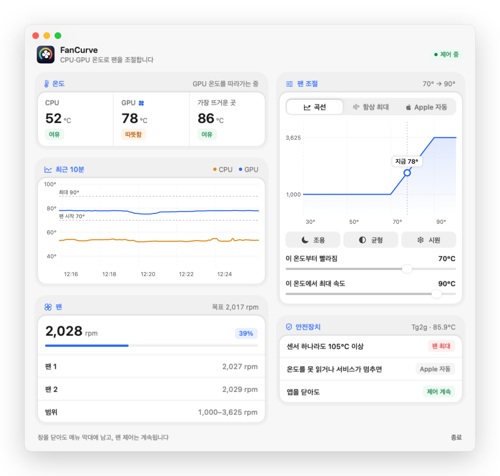
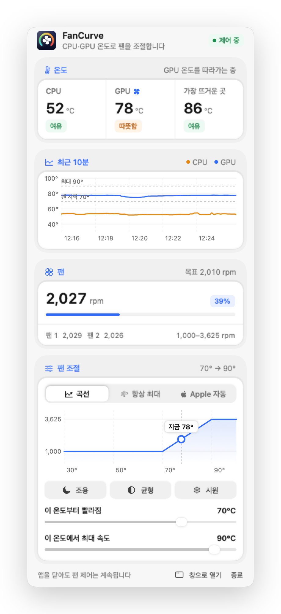
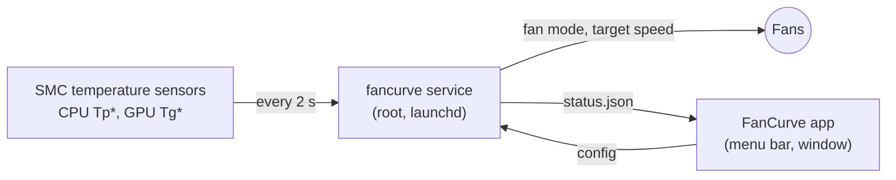

<h1 align="center">
  
</h1>

<p align="center">
  <a href="#install"></a>
  <a href="#faq"></a>
  <a href="#how-it-works"></a>
  <a href="LICENSE"></a>
</p>

<p align="center">
  <b>FanCurve drives an Apple Silicon Mac's fans from whichever of the CPU or GPU is hotter.</b><br>
  Install the package, then pick a curve from the menu bar. The fans follow the hotter chip every two seconds.
</p>

<p align="center">
  <b>English</b>&nbsp;&nbsp;|&nbsp;&nbsp;<a href="README.ko.md">한국어</a>
</p>

<p align="center">
  <a href="#install"><b>Install</b></a>&nbsp;&nbsp;&nbsp;|&nbsp;&nbsp;&nbsp;
  <a href="#usage">Usage</a>&nbsp;&nbsp;&nbsp;|&nbsp;&nbsp;&nbsp;
  <a href="#how-it-works">How it works</a>&nbsp;&nbsp;&nbsp;|&nbsp;&nbsp;&nbsp;
  <a href="#safety">Safety</a>&nbsp;&nbsp;&nbsp;|&nbsp;&nbsp;&nbsp;
  <a href="#faq">FAQ</a>
</p>

<picture>
  <source media="(prefers-color-scheme: dark)" srcset="docs/window-dark.png">
  
</picture>

## Why

Fan apps such as Macs Fan Control drive the fans from **one** sensor you pick. Pick a CPU sensor and the fans stay slow while a GPU job (a local LLM, for example) heats the chip. Pick a GPU sensor and the opposite happens.

FanCurve reads the **CPU average and the GPU average** every two seconds and feeds the higher one into your fan curve. Whatever the workload, the fans follow the hotter side.

<picture>
  <source media="(prefers-color-scheme: dark)" srcset=".github/assets/features-dark.svg">
  
</picture>

<details>
<summary>Features as a table</summary>
<br>

| Feature | What it does |
| --- | --- |
| **Follows the hotter side** | Sets fan speed from the higher of the CPU sensor average and the GPU sensor average. The app shows which side it is following. |
| **Curve, Max or Apple auto** | Three presets (Quiet, Balanced, Cool) and sliders for "start ramping at" and "full speed at". |
| **Safety first** | Full speed if any single sensor reaches 105 °C. Back to Apple's automatic control if the service stops or cannot read temperatures. |
| **10-minute chart** | CPU and GPU temperatures and your curve on one screen. The menu bar always shows the current temperature. |
| **Small footprint** | A small service written in C controls the fans. The SwiftUI app only reads a status file and needs no privileges. |

</details>

## Install

**Requirements:** an Apple Silicon Mac (M1 or later) on macOS 14 Sonoma or later. The app interface is in Korean.

### Option 1. Installer package (recommended)

1. Download `FanCurve-1.0.0.pkg` from [Releases](../../releases) and open it.
2. Follow the installer. A fan icon and the temperature appear in the menu bar.

> [!NOTE]
> The package is not signed with a developer certificate, so macOS may block it the first time.
> Open **System Settings, Privacy & Security**, click **Open Anyway** at the bottom, then open the package again.

### Option 2. One line in Terminal

```bash
curl -fsSL https://raw.githubusercontent.com/chanthr/FanCurve/main/install.sh | bash
```

This downloads the latest release package and installs it with `installer`.

### Option 3. Build from source

```bash
xcode-select --install          # once, if you have no build tools
git clone https://github.com/chanthr/FanCurve.git
cd FanCurve
sudo ./fan.sh install
```

`./fan.sh package` builds the same installer package into `dist/`.

> [!IMPORTANT]
> If you use **another fan app** such as Macs Fan Control, set its fans to **Auto** or quit it.
> Two programs writing fan speeds overwrite each other. FanCurve detects this and shows a conflict warning.

## Usage

<table>
<tr>
<td width="46%">
<picture>
  <source media="(prefers-color-scheme: dark)" srcset="docs/menu-dark.png">
  
</picture>
</td>
<td>

Click the fan icon in the **menu bar** to open the window on the left. Open **FanCurve** from Applications or Spotlight for a larger window. Closing the window keeps the app in the menu bar.

The **fan curve** is set by two temperatures: where ramping starts and where full speed begins. The chart below shows the three presets.

Between the two, speed rises in proportion to temperature. Speed goes up immediately and comes down over about a minute, so the fan noise does not jump around.

**Modes**

1. **Curve** follows your curve.
2. **Always max** is for long, heavy jobs.
3. **Apple auto** hands control back to macOS and only shows temperatures.

</td>
</tr>
</table>

<picture>
  <source media="(prefers-color-scheme: dark)" srcset=".github/assets/presets-dark.svg">
  
</picture>

<details>
<summary>Presets as a table</summary>
<br>

| Preset | Start ramping | Full speed |
| --- | --- | --- |
| Quiet | 55 °C | 90 °C |
| Balanced (default) | 50 °C | 80 °C |
| Cool | 45 °C | 72 °C |

</details>

## How it works

<p align="center">
  
</p>

<details>
<summary>Details</summary>
<br>



| Part | What it does |
| --- | --- |
| **Service** (`/usr/local/libexec/fancurve`) | Started by launchd at boot. Reads the CPU sensors (`Tp*`) and GPU sensors (`Tg*`) from the SMC, averages each group, feeds the higher one into the curve and writes the fan target speed. Changing fan speed needs root, so only this part runs as a service. |
| **App** (`/Applications/FanCurve.app`) | Reads the `status.json` that the service writes every two seconds and writes your curve to `config`. The service applies a new config within two seconds. |
| **Spike filter** | While the CPU idles, some sensors briefly report placeholder values such as 0, ±4 or 40.0. A reading is used only when at least 90% of the sensors are in the normal range (15 to 150 °C). Otherwise the previous reading is kept. |

</details>

## Safety

1. If any single sensor reaches **105 °C**, the fans run at full speed regardless of the curve.
2. When the service exits (uninstall, reboot, termination signal), the fans go back to **Apple auto**.
3. If temperatures cannot be read or fan speeds cannot be written for a while, the fans go back to Apple auto and the service stops.
4. Out-of-range values in the config file are clamped to a safe range.
5. On Macs without fans (MacBook Air), FanCurve leaves the fans alone and only shows temperatures.

In an emergency you can always hand the fans back to Apple:

```bash
sudo /usr/local/libexec/fancurve --auto
```

## Uninstall

```bash
sudo /Applications/FanCurve.app/Contents/Resources/uninstall.sh
```

This removes the app, the service and the config, and returns the fans to Apple's automatic control. If you installed from source, `sudo ./fan.sh uninstall` does the same.

## Commands

`fan.sh` in the source folder shows status and runs things directly.

| Command | What it does |
| --- | --- |
| `./fan.sh status` | Temperatures, fan speed, config and service status |
| `./fan.sh test` | Prints the curve calculation every two seconds without touching the fans |
| `./fan.sh log` | Shows the service log |
| `sudo ./fan.sh install` / `uninstall` | Install or remove |
| `sudo ./fan.sh auto` | Return the fans to Apple auto right away |
| `./fan.sh package` | Build the installer package into `dist/` |

## FAQ

<details>
<summary><b>The CPU temperature is higher than in other apps</b></summary>

FanCurve averages every CPU sensor in the SMC (`Tp*`). Tools such as macmon use a different set of sensors, so on an M4 Max FanCurve reads about 7 °C higher. For cooling, reading high is the safer side.
</details>

<details>
<summary><b>"Hottest spot" is above 95 °C. Is that fine?</b></summary>

That is the single hottest point on the chip. Under load it usually sits 15 to 20 °C above the average. Apple Silicon lowers its own clock if it gets hotter than that. FanCurve goes to full speed at 105 °C.
</details>

<details>
<summary><b>Does it work on Intel Macs?</b></summary>

No. Intel Macs use different SMC keys and value formats. The installer refuses to install on anything other than Apple Silicon.
</details>

<details>
<summary><b>Which Macs has it been tested on?</b></summary>

It was built and tested on a Mac Studio (M4 Max, macOS 26). Other Apple Silicon Macs use the same mechanism (write 1 to the fan mode key for manual, 0 for auto), but they have not been tested yet. If you try it on another model, please open an issue.
</details>

## Files

| Path | Contents |
| --- | --- |
| [`Sources/fancurve.c`](Sources/fancurve.c) | The root service: SMC reads, curve, fan writes, safety rules |
| [`Sources/FanCurveApp.swift`](Sources/FanCurveApp.swift) | The menu bar app and window |
| [`fan.sh`](fan.sh) | Build, install, status, test and packaging commands |
| [`install.sh`](install.sh) | One-line installer that fetches the latest release |
| [`packaging/`](packaging/) | Installer package scripts, launchd plists and the uninstaller |
| [`docs/`](docs/) | Screenshots and the app icon |
| [`.github/`](.github/) | Issue and PR templates, README images (`uv run .github/assets/make.py`) |

## Contributing

Please open an issue for problems and ideas.

| Template | Use it when |
| --- | --- |
| [**Bug report**](https://github.com/chanthr/FanCurve/issues/new?template=01-bug.yml) | Fans, temperatures or the app behave differently from this README |
| [**Improvement**](https://github.com/chanthr/FanCurve/issues/new?template=02-improvement.yml) | You have a better way, or you tested FanCurve on another Mac |

## License

[MIT](LICENSE) © 2026 chanthr
